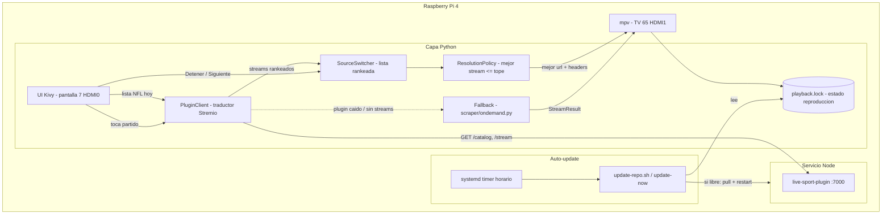

# Diseño — NFL Kiosk bajo demanda

## Visión general

El kiosk de Raspberry Pi reutiliza el motor de scraping del addon
`live-sport-plugin` (corriendo como servicio Node local) para listar partidos de
NFL de la jornada y resolver sus streams **bajo demanda**, manteniendo la UI Kivy y el
reproductor mpv actuales. Todo el protocolo Stremio queda encapsulado en un único
cliente Python (`PluginClient`); el resto del código sigue trabajando con el
esquema de evento que ya existe en el proyecto.

El diseño cubre tres capas:

1. **Integración con el plugin** (listar + resolver streams de NFL).
2. **Reproducción y controles táctiles** (mejor stream ≤ tope, Detener / Siguiente).
3. **Operación del dispositivo** (plugin como servicio, auto-update con lock de
   reproducción).

Mapea a los Requisitos R1-R10 de `requirements.md`.

### Principios de diseño

- **Encapsular Stremio en un solo lugar.** Solo `PluginClient` conoce
  `/catalog`, `/stream`, `nuvio_sport_<id>`, etc. La UI, el player y el fallback
  trabajan con el esquema de evento existente.
- **No reescribir lo que ya funciona.** Se reutilizan `ui/app.py` (tarjetas,
  `KioskRoot._resolve_and_play`), `player/mpv_player.py` (referrer, Wayland,
  dmabuf) y `scraper/ondemand.py` (fallback). El cambio es en la *fuente de
  datos*, no en la UI ni en el player.
- **Degradar, no fallar.** Si el plugin no responde o no trae streams, se cae al
  scraper Python existente. Si no hay stream reproducible en 30 s, se vuelve y se
  marca "no disponible".
- **Config, no código.** Resolución, URL del plugin y timeout viven en
  `config/kiosk.yaml`.

## Arquitectura



Flujo resumido:

1. La UI pide a `PluginClient` los partidos NFL de la jornada → `GET /catalog`.
2. Al tocar un partido, `PluginClient` resuelve streams → `GET /stream`, los
   entrega rankeados a `SourceSwitcher`, y `ResolutionPolicy` elige el mejor ≤ tope.
3. mpv reproduce en HDMI1; se marca `playback.lock`.
4. Los botones Detener / Siguiente operan sobre `SourceSwitcher` y mpv.
5. El updater horario solo aplica si `playback.lock` está libre; si no, deja la
   actualización pendiente y la aplica al terminar la reproducción.

## Componentes

### 1. PluginClient (nuevo) — `scraper/plugin_client.py`

Única clase que habla el protocolo Stremio. Traduce las respuestas del plugin al
esquema de evento del proyecto (el mismo que produce `scraper/main.py`):

```python
# Esquema de evento (ya existente en el proyecto)
{
  "id": "nuvio_sport_<matchId>",   # id del plugin, reutilizable en /stream
  "title": "Team A vs Team B",
  "league": "NFL" | None,           # derivado del título (heurística)
  "sport": "american_football",
  "start_time": "2026-10-17T18:30:00Z" | None,
  "stream_url": None,               # se rellena al resolver
  "referrer": "",
  "source": "live-sport-plugin",
  "status": "live" | "upcoming" | "unavailable",
}
```

Responsabilidades y API:

```python
class PluginClient:
    def __init__(self, base_url: str, timeout: float): ...

    def is_up(self) -> bool:
        """GET /health (o /manifest.json). False si el plugin no responde."""

    def list_nfl_gameweek(self) -> list[dict]:
        """GET /catalog/tv/nuvio_sports_american_football.json
        Filtra NFL (heurística de título) y la jornada en curso (ventana
        martes→lunes que contiene hoy) por start_time.
        Devuelve eventos en el esquema del proyecto (sin stream_url aún)."""

    def resolve_streams(self, event_id: str) -> list[Stream]:
        """GET /stream/tv/<event_id>.json
        Descarta 'Support Us' y streams sin url reproducible.
        Devuelve la lista YA rankeada (mejor primero), preservando el orden."""
```

Detalles de la integración (confirmados en el reporte de investigación
`.agents/tasks/nfl-kiosk-ondemand/plugin-api-findings.md`):

- **Sin segmento de config** en la URL: se usan las rutas Stremio planas.
- **Catálogo NFL:** `GET /catalog/tv/nuvio_sports_american_football.json`. No
  existe catálogo "NFL" ni campo `league` fiable; el filtro NFL (vs. college) es
  **heurística de título** del lado Python. Esto es consistente con el alcance ya
  acordado (solo NFL, NCAA fuera).
- **"De hoy":** el catálogo live/upcoming no filtra por día; se filtra en Python
  por `start_time.date() == hoy` en la zona del kiosk. `status` se deriva de
  live/upcoming (ventana de 4 h para americanos) y del resultado de `/stream`.
- **Resolver:** tomar `meta.id` (`nuvio_sport_<matchId>`) y pedir
  `GET /stream/tv/<id>.json`. Devuelve **varias fuentes ya ordenadas** mejor→peor.
- **Reintento:** si la primera llamada trae pocas fuentes, repetir una vez tras
  ~3-5 s (el plugin cachea las fuentes lentas entre llamadas).
- **Descartes:** la entrada "🧿 Support Us" (sin `url`), los `🌐 Web Stream`
  (iframe, no reproducible por mpv) y cualquier stream sin `url` ni vídeo.

Modelo `Stream` interno (lo que `PluginClient` entrega a la capa de reproducción):

```python
@dataclass
class Stream:
    url: str
    source: str                 # provider parseado del title (DaddyLive, ...)
    resolution_height: int | None  # 1080, 720, ... o None si desconocida
    referer: str | None         # de behaviorHints.proxyHeaders.request
    origin: str | None          # idem
    label: str                  # title legible para la UI
```

### 2. ResolutionPolicy (nuevo) — `scraper/resolution_policy.py`

Selecciona el mejor stream dentro del tope configurable. La resolución es
**best-effort** (solo se conoce tras la verificación del plugin; puede venir nula
o como `'HD'`).

```python
def pick_best(streams: list[Stream], max_height: int) -> Stream | None:
    # 1. parsear altura: 'WxH' -> H ; 'Np' -> N ; 'HD'/None -> desconocida
    # 2. candidatos = height <= max_height OR height desconocida (no bloquear por falta de dato)
    # 3. como ya vienen ordenados por calidad+velocidad, devolver el primer candidato
    # 4. si no hay candidatos (todos > tope): devolver el de menor altura (R6.5)
    # 5. si la lista está vacía: None
```

Parseo de altura (del reporte §4): `stream.resolution` matchea `(\d+)x(\d+)` →
altura = segundo grupo; `(\d+)p` → esa altura; `'HD'`/`None` → desconocida (no se
descarta, pero cuenta como baja prioridad); fallback regex `(\d{3,4})p` sobre el
label.

### 3. SourceSwitcher (nuevo) — `scraper/source_switcher.py`

Mantiene la lista rankeada ya resuelta de un partido y permite saltar sin
re-consultar el plugin (R7, R9).

```python
class SourceSwitcher:
    def __init__(self, streams: list[Stream], max_height: int): ...
    def current(self) -> Stream | None     # posición actual
    def next(self) -> Stream | None         # siguiente; None si se agotaron (R7.4/R9.4)
    def has_next(self) -> bool
    def index(self) -> tuple[int, int]      # (actual, total) para "fuente 2 de 5" (R9.5, opcional)
```

La selección inicial usa `ResolutionPolicy.pick_best`; `next()` avanza por la
lista restante respetando el mismo tope.

### 3b. NflScheduleClient (nuevo) — `scraper/nfl_schedule.py`

Encapsula los fixtures de nflverse (igual que `PluginClient` encapsula Stremio).
Rellena los datos que al plugin le falten: nombres de equipo y `start_time`. El
plugin sigue siendo la fuente de la lista y de la autoridad live; esto es solo
**enriquecimiento** (R11, modelo b).

**Fuente:** CSV público de nflverse `nfldata/data/games.csv`, leído con `requests`
+ `csv` (sin dependencias nuevas). Columnas verificadas útiles: `game_id`,
`season`, `week`, `gameday` (fecha), `gametime` (hora ET), `weekday`,
`home_team`, `away_team` (códigos tipo "KC", "WSH", "SF").

```python
@dataclass
class ScheduleGame:
    game_id: str
    gameday: date
    start_time: datetime | None   # gameday + gametime, convertido de ET a zona del kiosk
    home_team: str                # código ("KC")
    away_team: str

class NflScheduleClient:
    def __init__(self, csv_url: str, cache_ttl: int, tz: str): ...

    def gameweek_games(self) -> list[ScheduleGame]:
        """Descarga (o usa caché) el CSV y devuelve los partidos de la JORNADA en
        curso: ventana martes 00:00 → lunes 23:59 (zona del kiosk) que contiene
        hoy. [] si la fuente no está disponible."""

    def enrich(self, event: dict) -> dict:
        """Empareja el evento del plugin con un ScheduleGame por código/nombre de
        equipo (reusa la lógica de términos de ui/teams.py) y rellena start_time
        y nombres de equipo si faltan. Devuelve el evento (mutado o igual)."""
```

Detalles y riesgos (verificados contra datos en vivo de nflverse):

- **`gametime` viene poblado** para pasados y futuros (ej. `'13:00'`, `'20:15'`)
  pero **sin zona**; nflverse usa **ET**. Convertir ET → zona del kiosk antes de
  mostrar (R11.3). Verificar la zona exacta en implementación.
- **Scores con lag:** no usar `home_score`/`away_score` para estado live (R11.4);
  el plugin manda en live (R6).
- **Caché local semanal** del CSV (R11.5): el CSV pesa ~2 MB y sus horarios cambian
  poco una vez fijados; se descarga **una vez por semana** y se reusa. Guardar en
  `data/` con marca de tiempo; `update-now` puede forzar la re-descarga.
- **Jornada en curso (martes→lunes):** no se usa el número de semana del calendario
  genérico; se calcula la **ventana martes 00:00 → lunes 23:59** (zona del kiosk)
  que contiene hoy y se filtran los `gameday` dentro de esa ventana. Así la jornada
  arranca el martes y cierra con el MNF del lunes. Cálculo: `martes =
  hoy - ((weekday - MARTES) mod 7)`; `lunes = martes + 6 días`.
- **Orden híbrido (R4.2):** la UI muestra la jornada completa, pero
  `NflScheduleClient`/UI priorizan arriba los partidos en vivo y los de hoy, y
  dejan los demás de la jornada como "próximos" debajo.
- **Degradación suave (R11.6):** si el CSV no se puede descargar, `today_games()`
  devuelve `[]` y `enrich()` devuelve el evento sin cambios; se registra en log.
- **Diferencia con la API HTTP `api.nfldata.org`:** se descartó porque devolvía
  `gametime` vacío; el CSV crudo sí lo trae. La fuente de verdad es el CSV.

### 4. Fallback — `scraper/ondemand.py` (existente, se reutiliza)

El scraper bajo demanda de StreamEast ya existe y produce
`StreamResult(url, referrer)`. Se mantiene como plan B (R5):

- **Listar:** si `PluginClient.list_nfl_gameweek()` falla o devuelve vacío, la UI
  usa la ruta actual basada en `events.json` / el scraper existente.
- **Resolver:** si `PluginClient.resolve_streams()` devuelve vacío para un
  partido, se invoca `ondemand.resolve_match(a_terms, b_terms, timeout)` y su
  resultado se envuelve como un `Stream` único.
- Todo uso de fallback se registra en el log (R5.4).

### 5. UI Kivy — `ui/app.py` (existente, se adapta)

Cambios mínimos, sin rehacer la UI:

- `KioskRoot.refresh()` pasa a obtener los partidos vía `PluginClient.list_nfl_gameweek()`
  (con fallback) y luego **enriquecer** cada evento con
  `NflScheduleClient.enrich(event)` (rellena equipos/`start_time` faltantes; R11).
  Si el schedule no está disponible, los eventos siguen tal cual. Las tarjetas
  (`MatchCard`) y el layout no cambian.
- `KioskRoot._resolve_and_play(card, a_terms, b_terms)` pasa a:
  1. `streams = PluginClient.resolve_streams(card.event_id)` (con reintento).
  2. Si vacío → fallback `ondemand.resolve_match(a_terms, b_terms)`.
  3. `switcher = SourceSwitcher(streams, max_height)`.
  4. `best = switcher.current()`; si `None` tras 30 s → marcar tarjeta
     "no disponible" (R6.6, usa el `set_status` existente) y volver.
  5. `player.play(best.url, referrer=best.referer)` + registrar `playback.lock`.
  6. Mostrar overlay de controles **Detener** / **Siguiente streaming** (R9).
- **Overlay de controles (nuevo, pequeño):** dos botones grandes.
  - Detener → `player.stop()`, liberar `playback.lock`, volver a la lista.
  - Siguiente → `s = switcher.next()`; si `None`, deshabilitar/avisar (R9.4); si
    no, `player.play(s.url, referrer=s.referer)`.
  - Indicador opcional "fuente N de M" vía `switcher.index()`.

El `event_id` del plugin (`nuvio_sport_<id>`) se guarda en la `MatchCard` para la
resolución. Para el fallback se siguen usando los términos de equipos (`a_terms`,
`b_terms`) que la UI ya calcula (vía `ui/teams.py`).

### 6. mpv — `player/mpv_player.py` (existente, cambio menor)

El player ya acepta `referrer`. Se añade soporte opcional para `Origin` cuando el
stream lo requiere (streams `.m3u8` directos marcados `notWebReady` con
`behaviorHints.proxyHeaders`). Para los streams proxied por `/api/manifest` (la
mayoría) no hacen falta cabeceras y se reproduce tal cual.

- Si `Stream.origin` existe, se añade `--http-header-fields='Origin: <origin>'`
  (junto al `--referrer` ya soportado).
- No cambia nada de la salida de pantalla (Wayland/dmabuf/HDMI1).

### 7. Configuración — `config/kiosk.yaml` (nuevo)

```yaml
# Configuración del kiosk (R8)
plugin:
  url: "http://localhost:7000"   # servicio Node local
  resolve_timeout: 30            # segundos máx. "cargando..." (R6.6)
  retry_delay: 4                 # segundos antes de reintentar /stream una vez
playback:
  max_resolution: 1080           # tope de altura; mejor stream <= este valor (R6.3)
schedule:
  csv_url: "https://github.com/nflverse/nfldata/raw/master/data/games.csv"
  cache_ttl: 604800              # validez de la caché del CSV: 1 semana (R11.5)
  timezone: "America/Mexico_City" # zona del kiosk para "de hoy" y conversión de ET
```

Carga con defaults seguros: si falta el archivo o un valor es inválido, se usan
los defaults y se registra advertencia (R8.3). Lector pequeño en
`scraper/kiosk_config.py` (reutiliza PyYAML, ya en deps).

### 8. Servicio del plugin — `setup/plugin.service` + `setup/10-plugin-service.sh` (nuevo)

Unidad systemd que arranca el plugin Node (R3):

```ini
[Unit]
Description=live-sport-plugin (Nuvio/Stremio addon) para el kiosk NFL
After=network-online.target
Wants=network-online.target

[Service]
Type=simple
User=karlos
WorkingDirectory=/home/karlos/Kiro/scrapper/live-sport-plugin/live-sport-plugin
Environment=PORT=7000
Environment=ADDON_URL=http://localhost:7000
Environment=DONATION_URL=disabled
ExecStart=/usr/bin/node dist/index.js
Restart=always
RestartSec=5

[Install]
WantedBy=multi-user.target
```

- `ADDON_URL=http://localhost:7000` → las URLs de stream apuntan a localhost
  (reporte §6/§11). `DONATION_URL=disabled` → quita la entrada "Support Us".
- El script `10-plugin-service.sh` instala Node >= 22 si falta, hace
  `npm ci && npm run build` (ncc + WASM) **antes** de activar el servicio (R3.5),
  e instala/activa la unidad.
- `Restart=always` cubre R3.2 (auto-restart). Si el plugin aún no está listo, la
  capa Python lo trata como fuente caída y usa fallback (R3.4 / R5).

### 9. Auto-update del repo propio — `setup/update-repo.sh` + unidades (nuevo)

Mapea R1 (y R10 para el lock). Lógica del script:

```text
update-repo.sh:
  1. si playback.lock activo (y el proceso mpv vive) -> marcar PENDING, salir 0  (R1.8, R10.3)
  2. git -C <repo> fetch origin main
  3. si no hay commits nuevos y no hay PENDING -> salir 0 (R1.3)
  4. si working tree sucio e impide fast-forward -> log + abortar sin tocar (R1.6)
  5. git merge --ff-only origin/main
  6. (si el submódulo cambió por el pull) git submodule update --init
  7. reiniciar servicios afectados: kiosk UI + plugin.service (R1.4)
  8. limpiar marca PENDING
  9. cualquier fallo -> log, conservar estado anterior en ejecución (R1.7)
```

- `update-now` es el mismo script invocado a mano (R1.5), con una opción
  `--force` que **igualmente respeta el lock de reproducción** (no interrumpe un
  partido; para eso está Detener).
- Unidades: `scrapper-update.service` (oneshot que corre el script) y
  `scrapper-update.timer` (`OnCalendar=hourly`, `Persistent=true`) (R1.1).
- **Aplicar pendiente al terminar la reproducción (R1.9):** al liberar
  `playback.lock` (en Detener / fin de stream), si existe marca PENDING, la UI
  dispara `systemctl start scrapper-update.service` (vía un helper sin privilegios
  elevados innecesarios; el `sudo` sin contraseña ya existe en el dispositivo).

### 10. Update controlado del plugin — `setup/update-plugin.sh` (nuevo)

Mapea R2. **No** se ejecuta dentro del timer horario (R2.3): es un acto manual
deliberado.

```text
update-plugin.sh:
  1. si playback.lock activo -> marcar PENDING plugin, salir (R2.5 / R10.3)
  2. git -C <submodule> fetch upstream
  3. integrar: git merge --ff-only upstream/main  (o rebase controlado)
  4. git -C <submodule> push origin main           # actualizar el fork backich99
  5. npm ci && npm run build                        # rebuild WASM antes de reiniciar (R2.4)
  6. en el repo raiz: git add <submodule> && commit "chore: bump plugin submodule" (R2.2)
  7. systemctl restart plugin.service
```

## Lock de reproducción — `playback.lock` (R10)

Fichero de estado en `/run/scrapper/playback.lock` que contiene el PID del `mpv`
activo. Se usa `/run/` (tmpfs): se limpia en cada arranque, así un lock obsoleto
por corte de energía desaparece solo (más robusto que `data/`). El directorio
`/run/scrapper/` se crea al iniciar la app (o vía `RuntimeDirectory=scrapper` en
la unidad systemd del kiosk):

- **Crear:** al lanzar mpv con éxito (R10.1).
- **Limpiar:** al `player.stop()` o cuando mpv termina solo (R10.2). La UI vigila
  `player.is_playing()` (ya existe) para detectar fin de stream.
- **Leer (updater):** antes de aplicar cualquier update. Si el lock existe **y** el
  PID sigue vivo → reproducción activa → posponer (R10.3). Si el lock existe pero
  el PID ya no vive → lock obsoleto → ignorar y continuar (R10.4).

Esto garantiza que ninguna actualización reinicie servicios durante un partido, y
que un cierre inesperado de la app no bloquee las actualizaciones para siempre.

## Modelos de datos

| Modelo | Dónde | Campos |
|---|---|---|
| Evento | esquema del proyecto (existente) | `id, title, league, sport, start_time, stream_url, referrer, source, status` |
| `Stream` | `plugin_client.py` | `url, source, resolution_height, referer, origin, label` |
| `ScheduleGame` | `nfl_schedule.py` | `game_id, gameday, start_time, home_team, away_team` |
| Config kiosk | `config/kiosk.yaml` | `plugin.*, playback.max_resolution, schedule.csv_url, schedule.cache_ttl, schedule.timezone` |
| `playback.lock` | `/run/scrapper/playback.lock` | PID de mpv activo |

## Flujos detallados

### Flujo A — Listar NFL de la jornada (R4, R11)
1. UI `refresh()` → `PluginClient.is_up()`.
2. Si up → `list_nfl_gameweek()` (`GET /catalog`, filtro NFL + ventana jornada
   martes→lunes) → eventos.
3. Enriquecer cada evento con `NflScheduleClient.enrich()` (equipos/`start_time`
   faltantes; R11). Si el schedule no está disponible, continuar sin enriquecer.
4. Ordenar híbrido: en vivo y de hoy arriba; resto de la jornada (próximos) debajo
   (R4.2). Pintar tarjetas.
5. Si plugin down o vacío → fallback a la ruta `events.json`/scraper actual
   (R4.5/R5.1).
6. Las tarjetas marcadas "no disponible" previamente se muestran como tal (R4.4).

### Flujo B — Tocar partido y reproducir (R6)
1. UI `_resolve_and_play` → `resolve_streams(event_id)` (con 1 reintento).
2. Si vacío → fallback `ondemand.resolve_match(a_terms, b_terms)` (R5.2).
3. `SourceSwitcher` + `ResolutionPolicy.pick_best(max_height)`.
4. Reproducir mejor stream en mpv (con `referer`/`origin` si aplica) + lock.
5. Si no hay stream reproducible en `resolve_timeout` (30 s) → marcar
   "no disponible", volver a la lista (R6.6).
6. Mostrar controles Detener / Siguiente (R9).

### Flujo C — Siguiente fuente (R7, R9)
1. Usuario pulsa Siguiente → `switcher.next()`.
2. Si hay → `player.stop()` + `player.play(next.url, referer=...)` (sin re-consultar).
3. Si no hay más → avisar/deshabilitar, permitir Detener (R7.4/R9.4).

### Flujo D — Update con reproducción activa (R1, R2, R10)
1. Timer dispara `update-repo.sh`.
2. Lee `playback.lock`: si activo → marcar PENDING y salir (R1.8).
3. Al pulsar Detener / fin de stream → liberar lock → si PENDING, aplicar update
   ya (R1.9). Si la reproducción nunca termina, el siguiente tick reintenta (R1.10).

## Manejo de errores

| Situación | Respuesta |
|---|---|
| Plugin no responde (`is_up` False) | Fallback a scraper/`events.json`; log (R3.4/R5.1) |
| `/stream` vacío para un partido | Fallback `ondemand.resolve_match`; si también vacío → marcar "no disponible" |
| Timeout 30 s sin stream | Abortar, volver, marcar "no disponible" (R6.6) |
| Todos los streams > tope | Elegir el de menor altura (R6.5) |
| Resolución desconocida (`HD`/None) | No bloquear; tratar como aceptable de baja prioridad |
| Stream `.m3u8` directo con headers | Pasar `Referer`/`Origin` a mpv desde `behaviorHints` |
| Working tree sucio en update | Abortar update sin tocar; log (R1.6) |
| Lock obsoleto (mpv muerto) | Ignorar lock, continuar update (R10.4) |
| Fallo en build del plugin | No activar/reiniciar servicio; conservar el anterior (R1.7/R3.5) |

## Decisiones y notas

- **Por qué `PluginClient` y no llamar al plugin desde la UI:** aísla el protocolo
  Stremio en un punto; si el plugin cambia su API, solo se toca una clase.
- **Por qué filtrar NFL en Python:** el plugin no separa NFL de college ni expone
  `league` fiable (reporte §2, §10). La heurística de título es la única señal.
- **Por qué el tope de resolución es best-effort:** la resolución solo se conoce
  tras la verificación del plugin y a veces es nula/`'HD'` (reporte §4, §10). Se
  documenta como límite blando, no garantía dura.
- **Por qué no usar `/api/matches`:** da el modelo crudo con `league`/equipos
  estructurados, pero es endpoint de debug restringido a loopback y sin contrato
  estable (reporte §1, §10). Se prefiere el contrato Stremio `/catalog` + `/stream`.
- **Fuente de verdad de la investigación:**
  `.agents/tasks/nfl-kiosk-ondemand/plugin-api-findings.md`.
